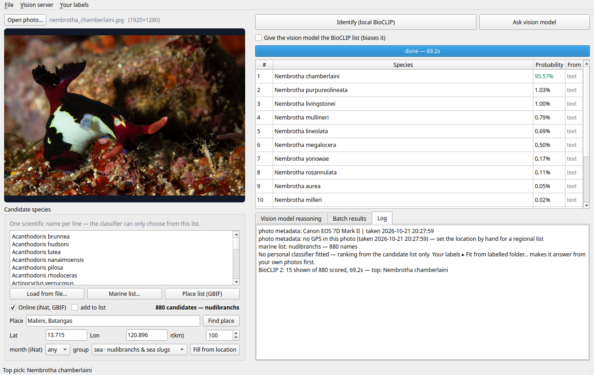

# Species ID Studio

A desktop app for identifying an organism from a photo, offline-first, with a
candidate list you control.

Two engines work together:

- **Tier 1 — BioCLIP 2 (local, in-process).** A zero-shot CLIP-family model that ranks
  a *supplied* list of candidate names against your photo. It cannot invent a name that
  is not in the list, which is the point: you constrain the answer space instead of
  trusting a fixed label set.
- **Tier 2 — a local vision LLM (optional).** A second opinion that describes
  diagnostic features and argues for a species. **Any vision model your `llama.cpp`
  build supports works** — `Qwen3-VL` is only the tested default, see
  [Choosing a vision model](#choosing-a-vision-model). Kept independent of Tier 1 by
  default (see [Two opinions, not one](#two-opinions-not-one)).

Around that sits the part that actually decides accuracy: **where the candidate list
comes from**. A photo can only be identified against names you give it.



<sub>Screenshot produced by `docs/make_screenshot.py` using the real model and the shipped
nudibranch list — the probabilities are BioCLIP's actual output, not mock-ups.</sub>


---

## Contents

- [Why it is built this way](#why-it-is-built-this-way)
- [Install](#install)
- [Models](#models)
- [Quick start](#quick-start)
- [Candidate sources](#candidate-sources)
- [Where it is weak, and why — the training data](#where-it-is-weak-and-why--the-training-data)
- [Two opinions, not one](#two-opinions-not-one)
- [Photo metadata](#photo-metadata)
- [Batch mode](#batch-mode)
- [Building your own name lists](#building-your-own-name-lists)
- [Tests](#tests)
- [Known limitations](#known-limitations)
- [Data sources and credit](#data-sources-and-credit)

---

## Why it is built this way

The core finding, from measurement rather than assumption:

> **Supplying a region- and group-specific candidate list is a bigger accuracy lever
> than changing the model.**

Two different kinds of list were compared on the same photos. A **global** one — all
7,405 marine names from a keyword export — and a **regional** one — the nudibranchs
recorded within 0–40 m of a single dive site, 393 at Anilao. Both put the right answer at
rank 1, so a long list does not degrade the ranking itself. What the long list costs is
text-encoding time, and what it dulls is the evidence behind the top pick: on one shrimp
the gap to the runner-up fell from 100% to 56%, though it still ranked first.

Scaling test over lists of 200 to 1,516 names — encoding grows roughly linearly,
per-photo scoring is flat, and top-1 never slipped:

| candidates | text encode | per-photo score | top-1 |
|---|---|---|---|
| 200 | 12 s | 0.49 s | 5/5 |
| 500 | 31 s | 0.49 s | 5/5 |
| 1,000 | 63 s | 0.49 s | 5/5 |
| 1,516 | 96 s | 0.49 s | 5/5 |

So the app is built around **narrowing**, not around a bigger model. Narrowing has a
failure mode of its own, though: narrowing by *group* must never drop the true species,
which is why each group maps to the widest taxon GBIF accepts (see
[Groups are deliberately broad](#groups-are-deliberately-broad)). Excluding the right
answer costs the entire identification; including extra names costs only some confidence.

---

## Install

Requires Python 3.11+ and a desktop session (Qt). Linux is what it was developed on;
macOS and Windows should work but are untested.

```bash
git clone https://github.com/<you>/species-id-studio.git
cd species-id-studio

python3 -m venv .venv
. .venv/bin/activate
pip install -r requirements.txt
```

`uv` works too and is faster:

```bash
uv venv .venv && uv pip install --python .venv -r requirements.txt
```

Launch:

```bash
python species_gui.py
```

Check the engines without opening the window:

```bash
python species_gui.py --selftest
```

> `--selftest` only verifies that the engine files and config are present. It does
> **not** build the window, so it can pass while the UI is broken — the tests do that.

---

## Models

Model weights are **not** in this repository (they are gigabytes). Put them here:

| What | Path | Size | Needed for |
|---|---|---|---|
| BioCLIP 2 checkpoint | `~/Models/speciesid/bioclip-2/open_clip_model.safetensors` | ~2.3 GB | Tier 1 identification |
| BioCLIP 2 config | `~/Models/speciesid/bioclip-2/open_clip_config.json` | small | Tier 1 identification |
| Vision LLM | `~/Models/qwen_image/text_encoders/Qwen3VL-8B-Instruct-Q4_K_M.gguf` | ~5 GB | Tier 2 second opinion |
| Vision projector | `~/Models/speciesid/mmproj-Qwen3VL-8B-Instruct-Q8_0.gguf` | ~0.75 GB | Tier 2 second opinion |

Paths are overridable in the app (`Vision server → …`) and in
`~/.config/species_studio.json`.

The vision LLM is served by a `llama-server` the app owns (it starts and stops it
itself, on `127.0.0.1:8081`), which is why a `llama.cpp` build with `--mmproj` support
is required for Tier 2. **Tier 1 needs none of that** — BioCLIP runs in-process on CPU
at roughly 0.3 s per photo.

`open_clip` loads a local model from a directory containing
`open_clip_config.json` + `open_clip_model.safetensors`. If loading fails, that pair is
the first thing to check.

### Choosing a vision model

Nothing in the code is specific to one model. Drop a weights file and its projector into
`~/Models` and the app finds the pair, so the vision picker offers it:

```
~/Models/<anything>/
    <model>.gguf        # the language model
    mmproj-*.gguf       # its vision projector — REQUIRED, and must match the model
```

It works because the conversation is plain: one photo, one written question. There is no
model-specific prompt engineering to break. Two things do change between models:

- **Which architectures are loadable.** That is decided by your `llama.cpp` build, not by
  this app. The `tools/mtmd/models/` directory in your checkout lists exactly what your
  build can project. A model whose architecture is missing fails at load.
- **How much memory it wants.** Model and projector must both fit in GPU memory. A dense
  30B on an integrated GPU is slow for a single-photo question even when it fits, where a
  mixture-of-experts model of the same size is far faster — only a fraction of its
  parameters are read per token.

Measured sizes (Q4, weights plus projector): `Qwen3-VL-8B` ≈ 5.4 GB,
`Qwen3-VL-30B-A3B` ≈ 17.5 GB, `Kimi-VL-A3B-Thinking` ≈ 10.4 GB,
`Qwen3-VL-32B` (dense) ≈ 19.5 GB.

The projector must match the model. An `mmproj` from a different family can load and
produce nonsense, which is worse than refusing to start.

---

## Quick start

1. **Open a photo** (or drag one onto the window).
2. **Say where you were.** Either type a place in `Place` and press *Find place*, or
   type latitude/longitude directly (a GPS-tagged photo fills these itself).
3. **Say what kind of animal it is** in the `group` selector. You rarely know the
   species; you usually know the group, and the group decides the candidate list.
4. **Load a candidate list** — `Place list (GBIF)`, `Marine list…`, or
   `Load from file…` (see below).
5. **Identify (local BioCLIP)** → the ranked list appears, with probabilities.
6. Optionally **Ask vision model** for a second opinion.
7. **Copy a name** with `Ctrl+C` or right-click → *Copy name*
   / *Open in iNaturalist* / *Open in GBIF* / *Open in Google Images*.

The status line always shows **where the next lookup will search** — coordinates,
place name and radius — because a wrong location silently produces a plausible but
wrong species list.

---

## Candidate sources

The list box is the answer space. Three ways to fill it:

### `Place list (GBIF)` — what is actually recorded near you

Queries GBIF occurrence records around the coordinates, narrowed by group and
habitat, and ranks species by **how often they have been recorded there**.

```
GBIF: 14,173 occurrence records | ~100 km around 13.715,120.896
      | taxon Nudibranchia | 541 species
```

(Occurrence counts grow as GBIF receives records, so the record total will not match
exactly; the species count for a fixed area and filter is much steadier.)

#### There is no depth filter at all, on purpose

GBIF has no habitat switch: `isMarine`, `habitat` and `isTerrestrial` do not exist on
`/v1/occurrence/search` and are silently ignored. What exists is `depth`, which selects
the records that happen to **carry a depth reading** — and depth is reported
inconsistently. A depth filter can therefore only ever subtract, in two different ways:

| Anilao, 100 km | no depth filter | "has a depth reading" | + a 0–40 m band |
|---|---|---|---|
| nudibranchs | 541 | 398 | 393 |
| crustaceans | 1,672 | 1,100 | 220 |
| echinoderms | 668 | 533 | 192 |
| corals & anemones | 458 | 197 | 63 |

- **Records with no depth value are dropped by any depth filter.** 143 of the 541
  nudibranch species at Anilao are recorded there with no depth at all. They are not deep
  animals — their records lack the field.
- **Species recorded only deeper than the band are dropped too.** Small for nudibranchs
  (5 species), but at the same site **880 of 1,672 crustacean species and 341 of 668
  echinoderm species are recorded only below 40 m**. A 0–40 m band would show 220
  crustaceans out of 1,672, which reads as "the list is broken" when in fact the filter
  is doing exactly what it was asked.

So **the app has no depth control** — not even an "underwater only" switch. Narrowing by
*taxon*, broadly, is safe; narrowing by *depth* silently removes real species, and a
control that only ever subtracts is a trap rather than a feature. The result is the most
complete list GBIF can give you for that area, and the group selector keeps the taxa
right.

`fetch_candidates(depth=...)` still exists for scripts that want a range, and the CLI
takes `--depth MIN,MAX` with that warning in its help text. The GUI never passes it.

- **No account or API key required.**
- **Loading replaces the list** (there is an `add to list` checkbox if you want to
  merge instead).
- The count label names the taxon, e.g. `393 candidates — Nudibranchia`, so you can
  see the filter is applied.

#### Groups are deliberately broad

A candidate list that silently excludes the right answer gives the model a **zero**
chance of finding it, and no ranking can recover that. So every group maps to the
widest taxon that GBIF will accept, and where no single key covers a group the
queries are unioned:

```
crustaceans   Malacostraca + Maxillopoda + Copepoda + Branchiopoda + Ostracoda + Remipedia
worms         Annelida + Nemertea + Sipuncula + Chaetognatha
jellyfish     Scyphozoa + Cubozoa + Hydrozoa + Ctenophora
tunicates     Ascidiacea + Thaliacea + Appendicularia
algae_seaweed Rhodophyta + Ochrophyta + Chlorophyta
```

Earlier versions quietly mapped *crustaceans* to `Decapoda` (crabs only) and
*echinoderms* to `Asteroidea` (starfish only). At Anilao, 0–40 m that returned **39**
echinoderm species against **192** for the phylum, and **159** crustaceans against
**220** — mantis shrimps, krill, barnacles and isopods were all unreachable.

Two GBIF traps make this less obvious than it sounds: `Crustacea` and `Tunicata` each
match a real **genus** of that name, and several natural broad names do not exist in
the backbone at all (`Heterobranchia`, `Chondrichthyes`, `Actinopterygii`, `Teleostei`,
`Sacoglossa`). Genus- and species-rank matches are therefore rejected outright, not
just non-`EXACT` ones.

If in doubt, choose **`no group — I don't know`**: that applies no taxon filter and
returns everything recorded near you. A longer list costs a little ranking accuracy;
a short wrong list costs the identification.

### `Marine list…` — your own curated list, offline

**The name lists are not shipped here** — they are derived from *MarineLife Keywords
1.0* (2009), a commercial product this project does not redistribute. If you own a copy,
one command rebuilds them locally:

```bash
python make_marine_lists.py "/path/to/MarineLife Keywords 1.0.txt"
```

Reference run: 12,601 keyword records → 8,696 unique species → **7,405 distinct usable
names**, grouped so you can load the ~880 nudibranchs instead of all 7,405 marine
species. Synonymy collapses some records onto one accepted name; 632 genus-level and
226 unmatchable names are kept apart rather than guessed. Works with no network.
Full detail and options: [`docs/REGENERATE.md`](docs/REGENERATE.md).

### `Load from file…` — one scientific name per line

Any plain text list. Comments (`#`) and blank lines are ignored.

---

## Where it is weak, and why — the training data

BioCLIP 2 was trained on **TreeOfLife-200M**: 233 million images, 933,798 taxa, from GBIF,
Encyclopedia of Life, BIOSCAN-5M and FathomNet. The headline count hides where the weight
sits, and knowing the imbalance predicts the failures you will actually meet:

| image type | images | share |
|---|---|---|
| Citizen science (iNaturalist-style) | 171.1M | **73.4%** |
| Museum specimen: plants | 39.7M | **17.0%** |
| Museum specimen: insects | 6.9M | 3.0% |
| BIOSCAN-5M (DNA-barcoded insects) | 5.2M | 2.2% |
| Museum specimen: invertebrate zoology | 1.7M | 0.73% |
| Museum specimen: vertebrate zoology (all) | ~848K | 0.36% |
| **FathomNet (deep-sea imagery)** | **37.9K** | **0.016%** |

Underwater photography, in other words, is close to absent: **37,900 images across only 251
taxa**, all from deep-sea benthic surveys — a different world from a reef at 10 m. The
largest slab is citizen science, which for practical purposes means birds, plants and
insects photographed in daylight on land.

Note one trap when reading the card: FathomNet, EOL and BIOSCAN rows carry `Unidentified` in
the *image-type* column. That is a metadata gap, not a missing taxon label.

### What that predicts, measured

Thirty-six iNaturalist research-grade photos, one per species, 156 candidate species, two
model sizes:

| | BioCLIP 2 | BioCLIP 2.5 (Huge) |
|---|---|---|
| land photos, top-1 | 8/18 (44%) | **11/18 (61%)** |
| land photos, top-5 | 10/18 | 14/18 |
| land MRR | 0.498 | 0.684 |
| marine photos, top-1 | 4/18 (22%) | 5/18 (**28%**) |
| marine photos, top-5 | 5/18 | 8/18 |
| marine MRR | 0.277 | 0.383 |

A bigger model bought **+17 points on land and +6 underwater**. That is the training
imbalance showing up as a measurable ceiling, not as a bug you can prompt your way out of.

On this project's own photographs, zero-shot reaches **74.3% top-1** on 109 hand-picked
medoid photos (Philippines 78.3%, Lembeh 61.5%) and **70.8%** on 24 randomly sampled,
human-verified held-out photos. Medoid photos flatter the model — they are the most typical
frame of each animal; the random sample includes the awkward ones.

### The failure mode to recognise

Marine mistakes rarely look random. They **collapse onto a few attractor names**: one fish
(*Antennarius maculatus*) was top pick for three different species, and a green alga
(*Chaetomorpha coliformis*) was returned at 87–100% for both a nudibranch and an isopod. When
a top pick is confidently wrong underwater, check whether it is the same name you keep
seeing — that is a gap in the training data, and no amount of re-prompting will fix it.

### What follows for using this app

- **The candidate list matters more than the model.** Cutting 7,405 marine names down to the
  393 nudibranchs recorded within 40 m of one dive site is what puts the right answer at rank
  1; the same photo against the full list still ranks it 1st, but at a much thinner margin.
- **Your own labels beat a bigger model.** With labels, 1-NN reaches **90.0% top-1** on
  species you have examples of, against 65.0% for text ranking on the same photos. Fitting
  costs seconds and no GPU; BioCLIP 2.5 Huge costs ~2.5 GB and buys +6 points underwater.
- **Never trust an underwater top-1 on its own.** The app exists because of this: a second,
  independent opinion, a candidate list you chose, and labels you supplied are the three
  things that fix what the training data cannot.
- **It has no notion of habitat, depth or season.** Those are not concepts in an
  image-text model; the app provides them from GBIF/iNaturalist records instead.
- **There is no zero-shot marine classifier to switch to.** FathomNet-published models are
  *detectors* (bounding boxes for a fixed set of taxa), plankton classifiers are built for
  specific instruments, and there is no public marine BioCLIP fine-tune — the closest
  precedent is a butterfly fine-tune. Hence: labels, not a different download.

---

## Two opinions, not one

`Ask vision model` sends the photo to the local vision LLM. By default it is **blind**
to BioCLIP's answer, and that is deliberate.

The answer lands in the *Vision model reasoning* tab as plain text you own: select any
part and press `Ctrl+C`, or right-click for **Copy selection**, **Copy whole answer**,
and — when the selection looks like a binomial — direct links to look that name up in
iNaturalist, GBIF or Google Images. The model writes prose rather than rows, so a name
it mentions in passing is exactly what you want to check.

Observed in real use: BioCLIP put the correct species at rank 10 of ~540, and a vision
model that had been shown a candidate list simply restated rank 1 — which was wrong.
A second opinion is only worth asking for if it is independent.

So:

- **The candidate list is opt-in.** A checkbox — *"Give the vision model the BioCLIP
  list (biases it)"* — is off. Unticked, the model sees only the photo.
- **It reasons before naming.** The prompt demands diagnostic features first, then a
  name, and explicitly allows "not enough detail to name a species".
- **It gets context, but not answers.** Location, habitat and the assumed group are
  always included, framed as fallible:

  ```
  Context supplied by the user. It is a hint, not evidence, and it may be wrong —
  if the photo clearly contradicts it, say so and go with what you can see:
    - location: 13.715, 120.896 (Mabini, PH, BT), within roughly 100 km
    - habitat: underwater (marine records only)
    - assumed group (the user's own guess): sea · nudibranchs & sea slugs — i.e. Nudibranchia
  ```

- **Afterwards the app compares the two** and says where the vision answer sat in
  BioCLIP's ranking:

  ```
  cross-check: the vision model named X, which BioCLIP ranked #10 (1.4%)
               — the two disagree on the top pick
  cross-check: the vision model agreed with BioCLIP's top pick (Y, 69.5%)
               — not independent evidence, and if that pick is wrong both are wrong
  ```

`top_k` (how many ranks are shown) defaults to **15**; raise it in
`~/.config/species_studio.json`.

---

## Photo metadata

EXIF is read when a photo is opened or batched:

| Field | Used for |
|---|---|
| GPS | fills Lat/Lon, which drives the regional candidate list |
| Date | reported (month filtering is available but off by default — see below) |
| Make/Model | reported |

**Month filtering is off by default.** Enabling it is expensive: the same Anilao query
returns 1,357 records / 314 species unfiltered and 2 records in January. GBIF coverage
is sparse and survey-driven per month, so a month filter measures when people happened
to visit, not seasonality.

Most web images carry no metadata (in one real 22-image set: 9 had EXIF, 8 a date, 0
GPS). The app says so rather than failing silently.

---

## Batch mode

- **`Batch folder…`** — every image in a folder (optional recursion).
- **`Batch files…`** — pick photos by hand (ctrl-click for several).

Each photo is identified with **its own GPS and date**, so a set shot at one dive site
gets that site's list per photo. Results are auto-saved as CSV **and** JSON to
`~/species_results/`, and can be exported again from the Batch tab.

**Selecting a row previews the photo** in the viewer on the left — filenames like
`DSC_4821.NEF` tell you nothing about the animal. The preview deliberately does *not*
apply EXIF, so clicking through a batch cannot silently rewrite your search area.

Columns: photo, taken, GPS, most likely species, probability, candidate source.

---

## Your own labels: a personal classifier

BioCLIP alone ranks by text description. Give it a few labelled photos per species and it
stops guessing: the same frozen encoder, plus a nearest-neighbour lookup against your
labels, is what actually moved the number.

Measured on **24 human-verified held-out photos of 24 species**, never used as prototypes,
against 104 candidate species:

| method | top-1 | top-5 | MRR |
|---|---|---|---|
| zero-shot text ranking (no labels) | 70.8% | 95.8% | 0.798 |
| 1-NN against your labels | 75.0% | 83.3% | 0.783 |
| centroid — mean of your labels | 75.0% | 83.3% | 0.786 |
| **hybrid: labels where available, text fallback** | **91.7%** | **100%** | — |

The split is what matters, because the two methods fail in opposite directions:

| held-out photos | 1-NN | zero-shot |
|---|---|---|
| species you have labels for (20) | **90.0%** | 65.0% |
| species with no labelled example (4) | 0.0% — nothing to match | **100.0%** |

So labels give precision on the animals you know, text ranking gives coverage on the ones
you don't, and neither alone is the right system. Text ranking also has the better top-5
(95.8% vs 83.3%): it is the better *recall* arm.

### Using it in the app

1. Put your own photos in a folder and **rename each so the filename starts with the
   species**: `Chromodoris_anna_01.jpg`, `Chromodoris_anna_02.jpg`, `Synodus_variegatus.jpg`.
   Anything after the species is free text. Camera filenames (`OI3A2349.jpg`, `DSC_0123.jpg`)
   and unlabelled exports are ignored rather than guessed — `species_labels.py` decides
   what counts as a label.
2. **Your labels ▸ Fit from labelled folder…** — one pass over the folder, seconds to a
   couple of minutes depending on how many photos. The result is stored at
   `~/.config/species_studio/personal_classifier.npz` — in a folder named after the config
   file, so a test config and a real one can never share a classifier. It contains
   embeddings of your photographs: it is never written into the app directory and never
   into a repository.
3. Identify as usual. The first row now comes from your labels and is marked **your
   labels**; the rows under it come from the candidate-list text ranking and are marked
   **text**, covering the species you have not labelled. **Batch folders get the same
   treatment** — one encode per photo feeds both arms, and the CSV export carries the label
   answer in its own `your_labels_*` columns.

   The two arms are **not on the same scale and are not printed as if they were**: the
   label score is a cosine similarity (`sim 0.93`), the text score is a softmax probability
   (`31.00%`). The label arm's trustworthiness is its *margin* to the runner-up, which is
   in the log and the CSV.
4. **Your labels ▸ What is fitted?** reports photo and species counts, the folder it came
   from, and how many species rest on a single example. **Forget fitted classifier** deletes
   the fitted file and touches no photographs.

**Use averages instead of nearest photo** switches between 1-NN (default) and centroids.
At one example per species they measured identically; with several examples per species the
centroid usually wins, which is why the toggle exists rather than a hardcoded choice.

### Learning as you go — and why the provenance is the important part

Right-click a result and choose **Teach this photo as “X”**, or **Teach as another
species…**. The embedding is already computed for the identification, so teaching costs one
vector and a small file write — a full refit over hundreds of photos is not needed to learn
one. Measured: 307 KB → 313 KB per added photo. An exact or near-exact duplicate
(cosine ≥ 0.995 to a photo already labelled with that species) is refused rather than added,
so accepting the same frame twice cannot skew a species' neighbourhood.

**The trap, and what is recorded to survive it.** A label accepted from the app's own top
pick is not independent evidence: the classifier is being taught what it already believes.
Its margins rise without its accuracy doing so, and any evaluation over those labels measures
agreement with the proposer — which is exactly how a 97.1% figure got published earlier in
this project and then had to be corrected to 90.0%. Every example therefore carries its
origin, rank and confidence at the time:

| provenance | meaning |
|---|---|
| `human` | from a fitted folder, filenames as labels |
| `typed` | you typed a species the app did not suggest |
| `app:...` rank 1 | the app's own top pick — a confirmation, not evidence |
| `app:...` rank > 1 | you picked a lower row, i.e. the app was wrong and you corrected it |

**"What is fitted?"** reports the split, and any `app:` count is labelled as confirming what
the model already believed. Only `human` and `typed` labels are independent ground truth, so
those are what an honest accuracy number must be computed on.

Practical advice: teaching a *correction* (the right species was not rank 1) is the most
valuable thing you can do; teaching a *confirmation* of the top pick mostly makes the
classifier louder. Both are worth having, but they are not the same thing, and the app keeps
them apart.

### The label arm answers only inside the group you asked for

The classifier scores against the candidate list — so an answer from your labels for a
species *outside* that list answers a different question. Reported case: group "reef &
bony fishes", and a nudibranch appeared at rank 1, pushing the correct fish to rank 2. The
label arm ignores the candidate list by construction, so the app now passes the scored list
as a **scope**:

- the label answer is dropped from the table when its species is not in the list;
- the log says so plainly — *"your labels recognised “Nembrotha chamberlaini” (confident,
  margin 0.188) but that species is not in the selected group"* — because silence would hide
  a genuine recognition;
- the same rule applies to batch rows and to the CSV, so a group-scoped run cannot export a
  species outside the group.

**A weak label answer no longer leads.** "weak" means the closest label is not clearly
better than another (margin < 0.03), so it is shown *below* the top text result, still
flagged. An "uncertain" answer (0.03–0.06) still leads, flagged: a flagged candidate beats
no candidate, but a hint that cannot distinguish two species should not be presented as the
best available answer. When both arms name the same species there is one row, attributed to
your labels — agreement is evidence, not a demotion.

### It flags, it does not refuse

A rejection threshold cannot be made both safe and useful here. Measured with 24 verified
animal photos as positives and 22 deleted non-subject photos as negatives:

| margin threshold | true animals refused | non-subjects accepted |
|---|---|---|
| ≥ 0.04 | 3 of 24 | 5 of 22 |
| ≥ 0.06 | 5 of 24 | 3 of 22 |
| ≥ 0.10 | 12 of 24 | 1 of 22 |

Absolute similarity is no help either: non-subjects reached 0.932 while real animals went as
low as 0.795, so any similarity floor rejects animals before it rejects junk. Because
excluding the true species costs the whole identification, the app **never silently
refuses** — it shows the closest label with a confidence word, explains the margin in the
log, and lets you see it is weak. A photograph of a spider and a butterfly each came back as
a confident marine species before the labels existed; now that is visible rather than
plausible.

### A correction worth stating

An earlier figure in this README read 97.1% for 1-NN. That was measured before the held-out
labels had been human-checked, so filenames still carried whatever the machine had proposed
— self-consistent, not correct. Once checked, 6 of those 40 proposals turned out to be
wrong, and the honest number on species with labels is **90.0%**. An unverified label is not
ground truth, and an evaluation built on one measures agreement with the proposer.

### Offline evaluation tools

```bash
python make_heldout.py  <labelled>      # random held-out photos to label — never by confidence
python eval_heldout.py  <labelled>      # the table above, recomputed on your own labels
python bootstrap_confirm.py <labelled>  # propose labels for unlabelled photos, for correction
```

Held-out photos are sampled at **random, never by confidence**: choosing confident photos
flatters the result, which is the easiest way to fool yourself here. `eval_heldout.py` also
splits species you have labels for from species you do not, and counts withdrawn photos,
because deleting a wrong proposal hides an error while deleting a non-subject does not.

---

### GBIF cannot filter "bony fishes" — so it filters by order instead

There is **no ray-finned fish class in GBIF's backbone**. `species/match` answers `NONE` for
`Actinopterygii` at kingdom, phylum, class and superclass rank, and `Osteichthyes`,
`Teleostei` and `Actinopteri` do not exist either; `/species/search` only finds parasites
*named* after fish (`Deevirus actinopterygii`, a virus). The occurrence index does support
`classKey`, but with no class to point at it is useless here.

So this group used to run **with no taxon filter at all**, and the app then intersected a
top-1,000 species facet with the marine fish list. That facet is ordered by record count, so
at Anilao it is dominated by land birds — `Pycnonotus goiavier`, `Passer montanus` — and
"reef & bony fishes" returned **119 species** for Batangas, silently dropping every fish that
did not make the cut.

It now unions **24 fish orders** that GBIF does have: Perciformes, Scorpaeniformes,
Tetraodontiformes, Anguilliformes, Syngnathiformes, Pleuronectiformes, Beloniformes,
Clupeiformes, Mugiliformes, Atheriniformes, Ophidiiformes, Lophiiformes, Beryciformes,
Aulopiformes, Polymixiiformes, Lampriformes, Zeiformes, Gadiformes, Elopiformes,
Albuliformes, Osteoglossiformes, Gonorynchiformes, Stomiiformes, Myctophiformes. Of 37 orders
tried, 13 answer `NONE` because GBIF keeps the newer ones *inside* Perciformes —
Gobiiformes, Acanthuriformes, Carangiformes, Labriformes, Blenniiformes and others all fold
back into it, which is why Perciformes alone carries hundreds of species at one place.

The union also has to stay out of the GUI: the group's spec is a list of (name, rank)
tuples, and rendering it in the candidate-count label put 695 characters on one line and
pushed the window past the screen edge. Unions are summarised as "Perciformes + 23 more
taxa", the label wraps and yields its width (`QSizePolicy.Ignored`), and the count is
hard-capped at 60 characters even if something unexpected arrives.

Measured at Batangas (13.715, 120.896, 100 km): **1,990 species, up from 119**, of which 867
are in this project's curated fish list and the rest are GBIF names the 2009 list lacks. The
cost is encoding time: ~126 s for the first identification against ~8 s for the truncated
list, then cached. Deep-water orders (Myctophiformes, Stomiiformes, Gadiformes) are included
because a missing candidate costs the whole identification — trim them if the encoding time
matters more to you.

---

## Groups, and why every name needs one

The group selector exists so a photo is scored against a plausible list rather than all
7,405 marine names: nudibranchs (880) encode in about a minute, everything takes several,
and a narrower list also sharpens the margin between the top pick and the next.

Groups are assigned by matching taxon names in each species' lineage, so **a class missing
from the map strands every species in it** — reachable only through "all marine species".
That happened: `Gastropoda`, `Bivalvia`, `Polyplacophora`, `Ophiuroidea`, `Ctenophora` and
`Crocodylia` were absent, leaving **639 of 7,405 names (8.6%) with no group at all** —
every cone shell, cowrie, egg cowrie, sea hare, clam, chiton, brittle star, comb jelly and
crocodile. Nothing failed; the lists just quietly left them out.

Two fixes, both now permanent:

- The map covers the classes, using the same union of crustacean classes that the GBIF
  source needs (GBIF lineages never contain the word "Crustacea" — Decapoda sits under
  Malacostraca — so "all crustaceans" was missing crabs it could not name).
- `build_mkw_candidates.py` **fails the build if any name lands in no group**, and before
  failing it asks api.gbif.org for the lineage of each orphan, because the 2009 keyword
  list files some names under a phylum only. That rescued 111 of 117 such names; the last
  seven were solenogasters, salps, larvaceans, a marine iguana, sea otters and a polar
  bear, which now have groups of their own.

Current groups, by size: bony fishes 3,174 · gastropods 1,353 · sea slugs 938 · nudibranchs
880 · cephalopods 608 · crustaceans 435 · sharks & rays 405 · corals & anemones 316 ·
echinoderms 290 · crabs, shrimps & lobsters 283 · worms 127 · bivalves 106 · sponges 94 ·
jellyfish 92 · algae 89 · tunicates 83 · cetaceans 81 · bryozoans 34 · seals 34 ·
crocodiles 24 · turtles 6 · sea snakes 48 · sea spiders 5 · dugongs 5 · other molluscs 1.

Note that **spider crabs are crabs, not sea spiders**: *Xenocarcinus tuberculatus* is
Decapoda › Epialtidae, so it is in "crabs, shrimps & lobsters". Sea spiders are
Pycnogonida — chelicerates, not crustaceans — and only five of them are in this 2009 list.

---

## Building your own name lists

`make_marine_lists.py` runs all four stages in order — this is the command to use:

```bash
python make_marine_lists.py "/path/to/MarineLife Keywords 1.0.txt"
```

Under the hood it is four scripts, kept separate because the same four problems bite
every time and you may want to re-run one of them alone:

| stage | script | why it is its own step |
|---|---|---|
| parse | `lightroom_keywords.py` | the export is CR-only with tab-depth nesting; get this wrong and every name is garbage |
| modernise | `modernize_marinelife.py` | GBIF renames; needs a 45-minute resumable cache |
| repair | `repair_typos.py` | typos are dangerous — this refuses to guess a different species |
| emit | `build_mkw_candidates.py` | grouping is a judgement call, not a lookup |

```bash
python lightroom_keywords.py "MarineLife Keywords 1.0.txt"   # outline only
python modernize_marinelife.py --src marine_lists/marinelife_entries.json \
                               --cache marine_lists/mkw_gbif_cache.json \
                               --out marine_lists/marinelife_modern.json
python repair_typos.py --modern marine_lists/marinelife_modern.json \
                       --cache marine_lists/mkw_typo_cache.json
python build_mkw_candidates.py --dir marine_lists
```

Result: `marine_lists/*.txt`, one file per group, plus
`_UNRESOLVED_review_these.txt` (226 names kept rather than guessed) — and
`_genus_level.txt` for names only identified to genus.

**The typo rule is the important part.** A name is only "repaired" if it is within 2
edits per token and 3 total, and the result is confirmed to resolve to an active taxon.
`Chromi alta → Chromis alta` is accepted (1 edit). `Trapezia wardi → Trapezia tigrina`
is refused (a different crab, 6 edits). Every repair records from → to, distance, path
and evidence.

---

## Tests

```bash
python tests/test_gbif_naming.py    # naming rules, group mapping, geometry
python tests/test_typo_rules.py     # the typo safety predicate
python tests/test_lightroom.py      # keyword-export parsing
```

These three are pure logic — no network, no models, no Qt — and are what CI runs.

The full suite used during development (17 files) additionally covers the GUI end to
end, but needs PyQt6, the model files and network access, so it is not in CI. If you add
GUI tests, run them offscreen:

```bash
QT_QPA_PLATFORM=offscreen SPECIES_CFG=/tmp/test-cfg.json python tests/test_gui.py
```

**Always set `SPECIES_CFG` in tests.** It redirects the config file so a test cannot
rewrite your real settings — this is enforced by checking the config's hash before and
after a suite run.

---

## Known limitations

Stated plainly, because each one is a silent-wrong-answer if you do not know about it.

- **"Reef fish" cannot be filtered in GBIF.** `/species/204` *is* Actinopterygii, but
  every fish occurrence record carries `classKey = None`, so `taxonKey=204` returns 0
  records. The group therefore falls back to restricting the regional list against your
  own bony-fish names, and says so. For fish, the iNaturalist path
  (`Fill from location`) is better — it has a working Actinopterygii taxon.
- **There is no "land only" filter.** GBIF has no `isTerrestrial` (nor `isMarine`).
  Leaving depth unset does not select land — it stops excluding marine. Depth presence
  is *metadata*, not habitat: many marine records simply have no depth value.
- **Counts measure survey effort, not abundance.** 422 *Chromodoris annae* at Anilao
  means 422 catalogue records, not that it is the commonest animal on the reef.
- **Place names are ambiguous.** "Anilao" matches exactly one iNaturalist place —
  Anilao, *Iloilo*, ~1,000 km from the Batangas dive area, where only 4 nudibranch
  species are recorded. The dive area is filed as **Mabini, PH, BT (13.715, 120.896)**.
  The app asks you to confirm coordinates when a name matches only one place, for
  exactly this reason.
- **BioCLIP ranks plausibility, not certainty.** A hard species in a species-rich genus
  lands mid-list. It is a zero-shot image-text matcher, not a taxonomist.
- **The window's minimum width is ~1,300 px.** Below that it will overhang a small
  display; the layout cannot shrink further without restructuring the control rows.
- **`--selftest` does not build the window.** It checks engine files only.

---

## Data sources and credit

- **GBIF** — occurrence and backbone taxonomy via `https://api.gbif.org/v1`.
  Occurrence data is CC BY 4.0 / CC0 depending on the dataset; see
  <https://www.gbif.org/citation-guidelines>. This app queries the public API live and
  does not redistribute GBIF records.
- **iNaturalist** — place search and regional species lists via
  `https://api.inaturalist.org/v1`. Observations are individually licensed; the API is
  queried live.
- **BioCLIP 2** — image encoder from the BioCLIP project (Stevens et al., CVPR 2024;
  BioCLIP 2: Gu et al.). Check the model card for its licence before redistribution.
- **Qwen3-VL** — vision-language model by Alibaba Qwen, Apache-2.0. This is the
  **tested default for Tier 2, not a dependency**: any vision model your `llama.cpp`
  build supports can be used instead, and its licence is then yours to check.
- **MarineLife Keywords 1.0** (2009) — *MarineLife Keywords* was used to guide the
  marine candidate lists this project was developed against. **Neither the product nor
  any file derived from it is included in this repository.** `make_marine_lists.py` can
  consume a copy **you own** to build lists on your own machine; how you may use that
  copy is between you and its publisher, and nothing here grants or implies a licence to
  it. This project is not affiliated with, sponsored by, or endorsed by the publisher.

  What this repository does contain is its own work: the parsing, the GBIF
  modernisation, the typo-repair rules and the grouping (§ *Building your own name
  lists*). Taxonomic names are facts, and every name in a rebuilt list has been resolved
  against the GBIF backbone above, under GBIF's terms.

If you publish identifications made with this tool, cite GBIF and the underlying
observation datasets — a species list is only as good as the records behind it.

---

## License

MIT — see [LICENSE](LICENSE). **No name lists are bundled**, so nothing derived from a
third-party product is redistributed here. Third-party models keep their own terms; see
[Data sources and credit](#data-sources-and-credit).
